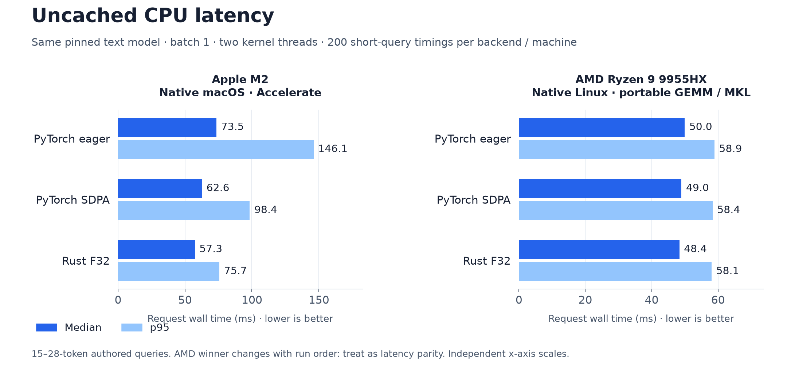
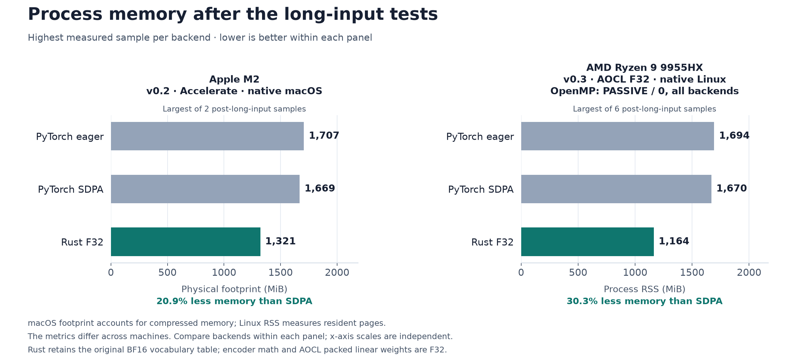

# Rust Embedding Runtime

A small, self-hosted embedding server written in Rust. Run a Docker image,
point an OpenAI client at it, and generate embeddings on your own CPU.

**First supported model:** `google/embeddinggemma-2` (text only). The project
is a foundation for more embedding models, not a universal model loader today.
Community implementation; not affiliated with Google.

## Docker

```sh
docker run --rm -p 127.0.0.1:8080:8080 --cpus=2 --memory=3g \
  ghcr.io/a-k-6/rust-embedding-runtime:0.3.0
```

The image includes the pinned text model. Inference needs no downloads, Python,
GPU, or external service. The image supports Linux AMD64 and ARM64; Docker selects the native image
automatically. ARM64 requires a CPU with NEON and FP16 instructions (such as
Apple Silicon through Docker). On macOS it runs inside Docker’s Linux VM.
AMD64 images use runtime-dispatched AOCL-DLP F32 kernels on AVX2/FMA CPUs.
Other supported CPUs use Candle kernels. No result cache or GPU is required.

```sh
curl http://localhost:8080/v1/embeddings \
  -H 'Content-Type: application/json' \
  -d '{"model":"google/embeddinggemma-2","input":"task: search result | query: What causes the northern lights?","dimensions":512}'
```

## OpenAI client

```python
from openai import OpenAI

client = OpenAI(base_url="http://localhost:8080/v1", api_key="unused")
result = client.embeddings.create(
    model="google/embeddinggemma-2",
    input=["task: search result | query: What causes the northern lights?"],
    dimensions=512,
)
print(len(result.data[0].embedding))
```

The API supports string, string-array, token-ID and token-ID-array input;
`float` and little-endian float32 `base64` encoding; ordered batch results;
and token usage. Token IDs must come from this model's tokenizer. OpenAI's
Python SDK may request base64 internally; both formats work.

**Task prefixes are explicit.** The server embeds exactly the text you send;
it does not silently add a prompt. For retrieval use:

- Queries: `task: search result | query: {query}`
- Documents: `title: {title} | text: {content}` (use `none` for a missing title)

Use the same model and dimensions for queries and corpus vectors. Outputs are
L2-normalized after truncation. The service supports 128, 256, 512 and 768
dimensions; smaller vectors reduce storage, not encoder work.

## Configuration

| Variable | Default | Meaning |
| --- | --- | --- |
| `MODEL_DIR` | `model` (`/opt/model` in Docker) | Checked text model directory |
| `LISTEN_ADDR` | `0.0.0.0:8080` | HTTP bind address |
| `THREADS` | `2` | CPU kernel threads, 1–64 |
| `QUANTIZATION` | `f32` | `f32`, experimental `q8_0` or `q4_k` |
| `API_KEY` | unset | Optional bearer token for `/v1/*` routes |

Set `API_KEY` before exposing the server outside your machine. Put TLS and
external traffic controls at your reverse proxy. Health endpoints stay public.
The server does not log request text, token IDs, vectors or API keys.

- `POST /v1/embeddings`: generate embeddings.
- `GET /v1/models`: list the supported model.
- `GET /health`: process liveness.
- `GET /ready`: model worker readiness (503 if the worker has stopped).

Limits: 256 KiB JSON body, 64 KiB per text, 1,024 tokens per input (including
special tokens), 16 inputs and 4,096 total tokens per batch. Requests exceeding
the context limit are rejected, never silently truncated. One resident model
processes batches sequentially, with at most eight queued batches; overload
returns 503. Batching is an API convenience, not fused batch inference.

F32 is the default. Quantization can reduce memory but is not guaranteed faster.
Numerical agreement with the official implementation is checked on the
[CPU comparison fixtures](benchmarks/AMD_REPORT.md). Broader relevance remains
unestablished; the authored retrieval pilot contains only 20 queries.
Image smoke tests verify real inference, agreement with PyTorch reference
vectors, normalization, API behavior, and
consistency across output encodings and dimensions.

## CPU comparison

See the [AMD optimization report and raw runs](benchmarks/AMD_REPORT.md) for
the v0.3 comparison against official Transformers/PyTorch eager and SDPA.
The [earlier two-machine report](benchmarks/REPORT.md) preserves the Apple M2
measurements. The goal is lower latency **and** lower memory. Native macOS
timings use Accelerate and do not measure Linux ARM64 Docker performance.

On the tested Ryzen 9 9955HX, the two-thread Rust build has **53.5% lower median
request latency** (23.9 ms versus 51.5 ms), **52.2% lower p95**, and **30.3%
lower post-test RSS** than PyTorch SDPA. Both latency
and memory wins hold in all six backend orders. This is sequential batch-one
latency; concurrent serving throughput has not been measured.
The same passive OpenMP waiting is applied to every backend. The report also
retains the earlier control round, where SDPA's median was 49.9 ms.





Two-thread native CPU, batch one, uncached 15–28-token authored queries.
Memory uses macOS physical footprint or Linux RSS within each machine.
The AMD report includes all six backend orders, longer inputs, numerical checks
and raw evidence. These measurements describe the tested CPUs and software;
they do not establish the fastest runtime across all consumer or server CPUs.
An [exploratory core sweep](benchmarks/AMD_REPORT.md#thread-scaling-and-openmp-waiting)
reached 19.2 ms median / 21.3 ms p95 with eight Rust threads on this CPU.

## Build locally

Requires Rust 1.98+ and a C build toolchain; model acquisition uses Python 3.10+
and the standard library. Native macOS builds use Apple Accelerate; the default
Linux source build uses Candle’s portable CPU kernels.

```sh
python3 scripts/download_model.py
cargo test --locked
cargo run --release --bin embedding-runtime
```

For the optimized Linux AMD64 backend, build the pinned AOCL dependency once.
This needs GCC 13+, CMake 3.26+, Ninja and OpenMP development files:

```sh
python3 scripts/build_aocl.py --output "$PWD/.aocl" --jobs 2
AOCL_ROOT="$PWD/.aocl" \
  cargo build --release --locked --features aocl --bins
OMP_WAIT_POLICY=PASSIVE GOMP_SPINCOUNT=0 THREADS=2 ./target/release/embedding-runtime
```

The helper verifies the upstream source archive before building. Linear weights
are reordered once at startup and the original linear allocation is released;
linear weights and encoder arithmetic remain F32. See the
[backend build and ownership details](crates/aocl-kernels/README.md).
The Docker build selects this backend automatically for AMD64.
The image also uses passive OpenMP waiting to reduce contention with Rayon
between linear operations. Source builds can select the same environment above.

The downloader pins upstream revision
`914f7f89142e33e77833254d9c9b90c3cef7303b`, verifies source checksums, and extracts
the unchanged text tensors. It downloads approximately 1.49 GB of source
weights; retained assets occupy approximately 574 MB. Weights are ignored by
Git and packaged into the image at build time. Runtime verifies fixed hashes
before loading. The full upstream model supports additional modalities and
longer contexts; this implementation supports text only with the limits above.

```sh
docker build -t rust-embedding-runtime .
docker run --rm -p 127.0.0.1:8080:8080 rust-embedding-runtime
```

## Rust library

Choose the Rayon pool size before loading the model; the AOCL weight handles
retain that thread count. For a small CPU allocation, start the application with
`RAYON_NUM_THREADS=2 OMP_WAIT_POLICY=PASSIVE GOMP_SPINCOUNT=0`. The HTTP server
configures its own pool from `THREADS`.

```rust,no_run
use rust_embedding_runtime::{Input, QuantMode, Runtime};
use std::path::Path;

fn main() -> anyhow::Result<()> {
    let mut runtime = Runtime::load(Path::new("model"), QuantMode::F32)?;
    let (vectors, tokens) = runtime.embed(&[Input::Text("Hello, world".into())], 768)?;
    println!("{} vectors, {tokens} tokens", vectors.len());
    Ok(())
}
```

The standalone `embedding-jsonl` binary also accepts one JSON request per line:
`{"text":"Hello, world","dims":768}`. Its model directory is a required positional
argument; `--quant f32|q8_0|q4_k` selects weight precision.

## Development and releases

```sh
cargo fmt --check
cargo clippy --locked --all-targets -- -D warnings
cargo test --locked
# With model assets available, exercise the real HTTP server:
python3 tests/smoke.py --binary target/release/embedding-runtime --model model
```

CI tests the Rust code. A `v*` tag builds native Linux AMD64 and ARM64 images, runs real-model
smoke tests on each architecture, and publishes the combined image only after both pass.
Image tags include the version and `latest`. Public image pulls need no login.

The core model implementation lives in `src/lib.rs`; HTTP transport lives in
`src/server.rs`. Future model backends should preserve this boundary and add
model-specific validation and reference fixtures.

Apache-2.0. See [LICENSE](LICENSE), [NOTICE](NOTICE), and
[dependency notices](THIRD_PARTY_LICENSES.txt).
