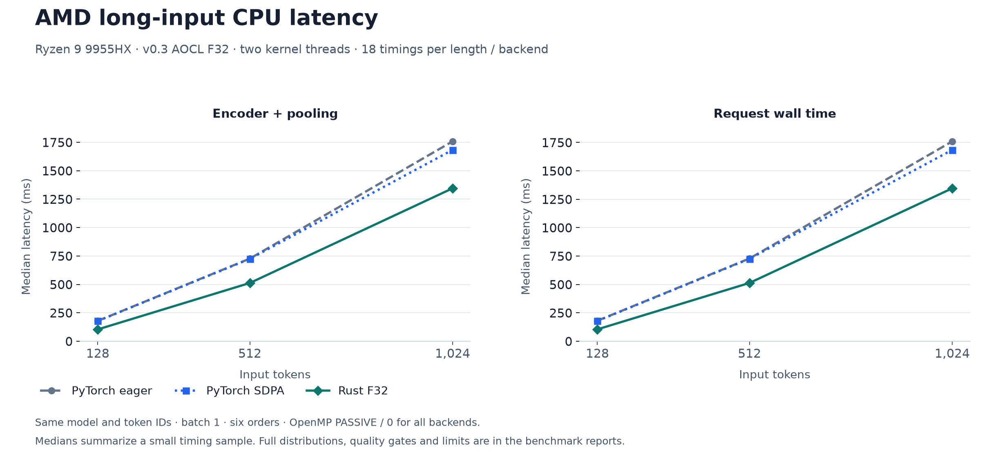
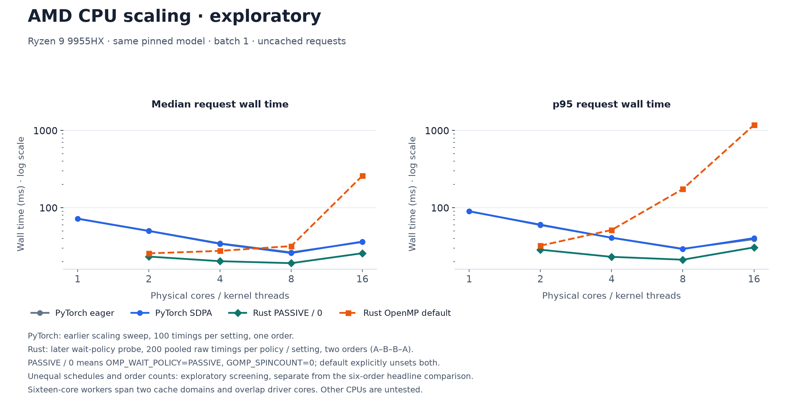

# AMD CPU optimization: v0.3

Measured 2026-10-22 on an AMD Ryzen 9 9955HX with the actual pinned
`google/embeddinggemma-2` text model. **Rust is faster and uses less memory
than both tested PyTorch backends** at the same two-thread allocation, across
all six backend orders. This establishes a result on this laptop and workload;
server CPUs, other models and other optimized inference engines remain untested.

## Results

600 measured short-query requests per backend, from 20 authored multilingual
15–28-token queries repeated in six fresh-process runs. Memory is the largest
of six process samples for each metric, in MiB.

| Backend | Encoder median / p95 (ms) | Request median / p95 (ms) | Short RSS | Post-long RSS | Peak RSS |
| --- | ---: | ---: | ---: | ---: | ---: |
| PyTorch eager | 50.86 / 61.09 | 52.13 / 62.50 | 1630.9 | 1693.7 | 1888.2 |
| PyTorch SDPA | 50.21 / 60.24 | 51.46 / 61.74 | 1631.0 | 1669.8 | 1888.1 |
| Rust F32 + AOCL | 23.32 / 28.84 | 23.93 / 29.51 | 1138.7 | 1164.0 | 1211.4 |

Against SDPA: **2.15× speedup in median request latency**, 52.2% lower request
p95, 30.2% lower short-query RSS, 30.3% lower post-long RSS and 35.8% lower peak
RSS. The smallest speedup across every short-query median/p95, engine/wall
metric and run order is about **2.03×**. Both references lose all these latency and
memory comparisons in every order.

All three backends use `OMP_WAIT_POLICY=PASSIVE GOMP_SPINCOUNT=0`, verified
against each worker's actual process environment. The
[earlier six-order control round](results/amd-aocl-balanced-2026-10-22/REPORT.md)
is retained: SDPA was 49.90/59.74 ms and Rust 25.72/32.56 ms median/p95 there.
That round did not record wait variables. The final setting improves Rust;
PyTorch's earlier median is slightly faster than its final-round median.
Both rounds independently pass the same speed, memory and quality criteria.

The earlier portable Rust backend was approximately tied with PyTorch on short
queries and slower on long inputs. Those [v0.2 results](REPORT.md) remain
available. The headline above uses freshly measured references from this round;
it does not mix timings from different rounds.



| Input length | PyTorch eager request median (ms) | PyTorch SDPA request median (ms) | Rust request median (ms) | Reduction versus SDPA |
| ---: | ---: | ---: | ---: | ---: |
| 128 tokens | 180.46 | 179.05 | 104.87 | 41.4% |
| 512 tokens | 728.38 | 725.91 | 513.31 | 29.3% |
| 1,024 tokens | 1760.00 | 1684.91 | 1346.62 | 20.1% |

Long-input comparisons pool 18 measurements per length/backend. All reported
pooled engine/wall median/p95 metrics beat both references. The sample is small;
this does not establish production tail latency. Long contexts remain a useful
optimization target, particularly attention and temporary allocations.

## Change and precision

Profiling the previous F32 path put roughly 85% of short-query encoder time in
linear operations; tokenizer time was about 0.04 ms. This instrumented screening
is diagnostic, separate from the uninstrumented acceptance timings. The backend
uses [AMD AOCL-DLP 5.3.2](https://github.com/amd/aocl-dlp/tree/fe36da707e6f25e8b3e2b742dfa5957d4484fca5)
F32 GEMM and reorders each constant linear weight once during model loading.
Inference reuses that CPU-specific representation. The original linear tensor
is released after reordering, rather than keeping both representations resident.
The packed representation is rebuilt at startup and never shared between CPUs.

Encoder arithmetic and linear weights remain **F32**. There is no result cache,
reduced-precision activation path or GPU. Rust retains the original BF16
vocabulary table and converts gathered rows to F32; the reference expands the
table to F32. That existing storage difference accounts for 256 MiB of the
memory advantage; framework and allocator overhead also differ.

The root runtime continues to forbid unsafe Rust. A small separate crate owns
the checked FFI handle, validates dimensions/buffer lengths and serializes calls
on a shared packed handle. AOCL thread counts are set through its thread-local
API. The backend selects kernels at runtime on Linux x86_64 with AVX2+FMA.
Unsupported targets retain Candle; native macOS retains Accelerate. AVX2-forced
kernel tests pass on this Zen 5 machine, but an older AVX2-only CPU has not been
physically tested.

Column-major weight layout and several portable GEMM thread thresholds were
screened and rejected because they did not provide a convincing latency win.
The optional `profile` feature adds phase timings for follow-up investigation;
the measured release build omits it.

## Thread scaling and OpenMP waiting

The first [equal-thread sweep](results/amd-aocl-scaling-2026-10-22/REPORT.md)
found poor Rust tails as core counts increased. AOCL uses OpenMP for linears,
while other encoder phases use Rayon. Idle OpenMP workers competing with Rayon
is a plausible explanation; the
[GNU waiting controls](https://gcc.gnu.org/onlinedocs/libgomp/GOMP_005fSPINCOUNT.html)
allow testing it without changing kernels or precision.

The subsequent [controlled Rust probe](results/amd-aocl-wait-policy-2026-10-22/REPORT.md)
runs fresh processes in default–passive–passive–default order at each thread
count, explicitly removing both wait variables for the default and setting
`OMP_WAIT_POLICY=PASSIVE GOMP_SPINCOUNT=0` for passive. Its 33-vector and all
100-ranking checks against the **first default Rust worker** pass for every
worker. PyTorch agreement is checked separately in the primary comparisons.
The probe records actual environment,
affinity masks and process CPU time; the query-block CPU total also includes
the 20 explicit-token validation calls.

The original scaling driver is preserved at
[`cee8c95`](https://github.com/A-K-6/rust-embedding-runtime/blob/cee8c95/benchmarks/scaling.py).
A later formatting change moves Markdown annotations outside the table; that
updated driver is used by the wait-policy probe. Each JSON records its exact
driver hashes. The runtime source and binary are identical across these probes.

| Physical cores / threads | Default Rust median / p95 (ms) | Passive Rust median / p95 (ms) |
| ---: | ---: | ---: |
| 2 | 25.68 / 32.30 | 23.33 / 28.63 |
| 4 | 27.65 / 51.52 | 20.33 / 23.15 |
| 8 | 31.89 / 174.68 | 19.17 / 21.25 |
| 16 | 259.77 / 1181.94 | 25.76 / 30.68 |

Each cell pools 200 request timings from two fresh processes. At eight threads,
query-block worker CPU time fell from 47.79/50.14 CPU-seconds in the two default
runs to 12.79/12.77 with passive waiting, alongside better latency. This supports
the contention explanation, without isolating every scheduler effect.



The chart includes the earlier PyTorch screening with 100 timings and one order
per count, alongside the later 200-timing Rust policy probe. These schedules
and policies differ; this is exploratory configuration evidence, separate from
the six-order headline comparison. Sixteen worker cores span two cache domains
and overlap the driver's CPU pair. No exclusive cores or fixed frequency.

The image defaults to two threads and passive waiting. On this 9955HX, the
fastest screened Rust setting was eight physical cores/threads. To use that
allocation on a machine with suitable CPU IDs:

```sh
docker run --rm -p 127.0.0.1:8080:8080 --cpuset-cpus=0-7 --cpus=8 --memory=3g \
  -e THREADS=8 ghcr.io/a-k-6/rust-embedding-runtime:0.3.0
```

Core IDs and the best count depend on the CPU, topology and workload. More
threads do not automatically mean lower latency. This sweep did not test
throughput from concurrent requests or multiple model replicas.

## Quality and protocol

- Same model revision `914f7f89142e33e77833254d9c9b90c3cef7303b`, checked model
  asset hashes, explicit retrieval prefixes, tokenizer, 768-dimensional mean
  pooling and normalization. Fixture SHA-256:
  `8c61c2f94cc2996cff4546d9ade325da2e26da09d47e4a667bf5b87eee37c525`.
- Same two physical worker cores, CPU IDs 0 and 1, in one last-level cache
  domain. The driver uses CPUs 8 and 9. All framework worker affinity masks are
  verified after startup and inference. Two intra-op/kernel threads and one
  PyTorch inter-op thread; BLAS/OpenMP environment limits are also two.
- Batch one, ten document embeddings outside query timing, five warmups,
  100 timed query requests per backend/order. Each of the six permutations runs
  each backend in a fresh process. Long inputs use the same explicit token IDs,
  one warmup and three measurements per length/order.
- Encoder timing includes pooling/normalization but excludes tokenization and
  JSONL IPC. Request wall time includes tokenization, IPC and serialization.
  Neither includes HTTP, networking, ranking or concurrent request scheduling.
- Every run checks 33 output vectors: ten documents, twenty queries and three
  long inputs. Maximum Rust absolute error is below **3.354e-7**; minimum cosine is
  **0.9999999999967**. Gates remain error ≤1e-4 and cosine ≥0.99999.
- All backends score authored hit@1 and hit@5 **20/20** in every run. Ordered
  top-five results match eager PyTorch on all 100 timed requests in each run.
  Text/explicit-ID tokenization agreement is also checked. Repeated timings do
  not create additional relevance labels or prove broad retrieval quality.
- Acceptance requires lower engine **and** wall median/p95 and lower short,
  post-long and peak RSS against **both** references, aggregated and in every
  order. That short-query criterion passes. Longer lengths are reported
  separately. No statistical significance claim is made.

This is a shared native Linux laptop: no exclusive cores, fixed frequency,
thermal isolation or CPU quota. Measurements cover this checkpoint, batch size
and input set. They do not establish the fastest runtime across all consumer
or server CPUs. EPYC/Intel testing, larger batches, concurrent serving and
broader retrieval evaluation are still needed for those claims.

## Provenance and reproduction

The measured runtime and drivers are at
[`d4ad97c`](https://github.com/A-K-6/rust-embedding-runtime/tree/d4ad97c97d1c3440a5b534d71120422ddeb2cdb9).
Each raw run retains all Rust/C shim/build-helper hashes, lockfile, binary hash,
readiness metadata and build declaration. The matrix verifies they stay fixed.

Native build: Rust **1.98.0**, Candle **0.11.0**, AOCL-DLP **5.3.2** at
`fe36da707e6f25e8b3e2b742dfa5957d4484fca5`, GCC **15.2.0**, CMake **4.1.2**,
OpenMP and static GNU runtime archives. No global `-march=native` or Rust
`target-cpu=native` flags. The final matrix records Rust **1.98.0**. The earlier
control round's `rustc` field records the host's default **1.91.0** executable,
while its explicit build used `cargo +1.98.0`. Both rounds use the identical
binary hash. The final driver explicitly selects 1.98 without changing the
host's default toolchain.
The [AOCL build manifest](results/amd-aocl-balanced-2026-10-22/aocl-build-manifest.json)
records pinned source, compiler/tool versions and library hashes.

References: official Transformers **5.20.2** `EmbeddingGemma2Model`, PyTorch
**2.14.1+cpu**, MKL, eager and SDPA attention, CPU F32, Python **3.12.13**.
Tokenizers Python **0.23.3** and Rust **0.22.2** use the same pinned asset and
are checked against common IDs.

See the [six-order report](results/amd-aocl-passive-balanced-2026-10-22/REPORT.md),
[aggregate JSON](results/amd-aocl-passive-balanced-2026-10-22/summary.json),
[prespecified matrix](results/amd-aocl-passive-balanced-2026-10-22/matrix.json),
and [commands](README.md). The raw six runs are linked from that report.
The static README charts preserve historical Apple v0.2 results alongside AMD
v0.3, with different versions/sample counts labelled explicitly.

AMD64 Docker images build this backend with **GCC 14.3 on Debian 12** and matching
shared GNU runtime libraries; Linux ARM64 uses Candle. Native benchmark numbers
above are not container performance measurements. Images include the actual
pinned model and undergo real inference/API checks on each native architecture
before publication.
