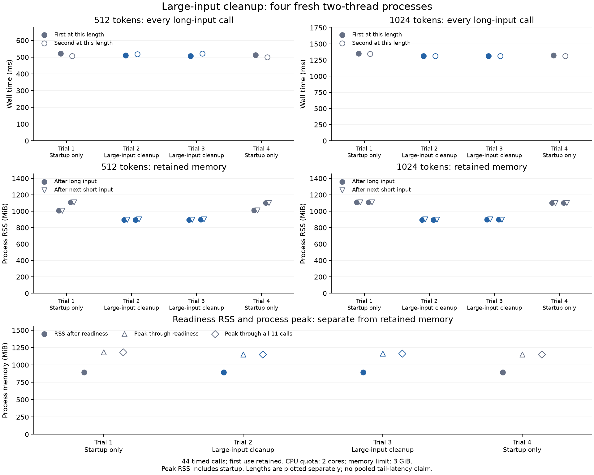

# Large-input memory comparison — 2026-10-22

Large-input cleanup lowered final process RSS from 1106.1 to 898.6 MiB on average (18.8%) across four fresh ABBA processes. All 44 calls passed numerical checks. This small probe does not establish a tail-latency speedup; every long-input timing is reported below.

Both versions retain the same pinned F32 model, tokenizer, task handling, normalization, dimensions and CPU backend. The previous version releases freed buffers once at startup. The candidate additionally releases freed temporary buffers after validated inputs of at least 512 tokens. Cleanup runs after inference temporaries are dropped, and its cost remains inside encoder and wall timing.



## Protocol and controls

- CPU: AMD Ryzen 9 9955HX 16-Core Processor; two F32 worker threads on two distinct physical cores sharing the last-level cache.
- Actual driver and worker cgroup readback: `cpu.max = 200000 100000`, `memory.max = 3221225472`. All worker thread masks were `[0, 1]`.
- Four fresh processes in previous/candidate/candidate/previous order. Each makes three official first-use calls, then two rounds of 512 tokens → short official recovery → 1024 tokens → short official recovery: 11 calls per process, 44 overall.
- The three official cases use 15, 26 and 27 tokens. The long inputs use repeated public model-native token ID 2; they measure agreement, not retrieval quality.
- Every first-use call is timed. No requests were excluded, retried or cached. No production reads or external inference services were used.
- Overall elapsed: 20.24 s within the 300-second budget (294 seconds for work plus six reserved for cleanup); startup limit 60 s, response limit 30 s.
- `RAYON_NUM_THREADS=2`, `OMP_NUM_THREADS=2`, `OMP_WAIT_POLICY=PASSIVE`, `GOMP_SPINCOUNT=0`; the complete checked environment is in the JSON.
- The Python driver shares the cgroup quota. Core exclusivity, clocks, thermal state and unrelated operating-system activity are not controlled. This result is specific to this CPU and protocol.

## Every fresh process

| Trial | Runtime | Startup wall ms | Ready RSS MiB | Final RSS MiB | Peak through readiness MiB | Peak through all calls MiB |
|---|---|---:|---:|---:|---:|---:|
| 1 | Startup only | 961.48 | 892.26 | 1108.77 | 1183.07 | 1183.07 |
| 2 | Large-input cleanup | 969.61 | 891.90 | 897.88 | 1149.87 | 1149.87 |
| 3 | Large-input cleanup | 934.25 | 892.17 | 899.25 | 1166.57 | 1166.57 |
| 4 | Startup only | 973.17 | 892.05 | 1103.40 | 1149.71 | 1150.67 |

Startup RSS is essentially the same because both versions already perform startup cleanup. Peak RSS includes model loading and varies between fresh processes; these measurements do not establish a repeatable startup-peak reduction. Final RSS includes recovery after the second 1024-token call.

## Long-input wall time, including cleanup

Both calls at each length are shown in execution order. There are only four samples per runtime and length, so no pooled or broad p95 claim is made.

| Trial | Runtime | 512 first ms | 512 second ms | 1024 first ms | 1024 second ms |
|---|---|---:|---:|---:|---:|
| 1 | Startup only | 521.35 | 507.69 | 1351.91 | 1346.44 |
| 2 | Large-input cleanup | 510.23 | 517.28 | 1313.94 | 1312.14 |
| 3 | Large-input cleanup | 507.84 | 521.61 | 1312.44 | 1312.41 |
| 4 | Startup only | 512.40 | 500.37 | 1323.56 | 1312.60 |

## RSS after long inputs and short recovery

Each cell lists first-round / second-round values. The cleanup span is part of the timings above. The startup-only executable has no per-input cleanup span.

| Trial | Length | RSS after long MiB | RSS after next short MiB | Cleanup span ms |
|---|---:|---:|---:|---:|
| 1 | 512 | 1005.64 / 1108.77 | 1005.64 / 1108.77 | — |
| 1 | 1024 | 1108.77 / 1108.77 | 1108.77 / 1108.77 | — |
| 2 | 512 | 894.82 / 895.64 | 897.07 / 900.73 | 2.341 / 3.324 |
| 2 | 1024 | 895.64 / 895.64 | 900.48 / 897.88 | 4.291 / 5.681 |
| 3 | 512 | 895.59 / 896.41 | 898.43 / 901.64 | 2.578 / 3.207 |
| 3 | 1024 | 896.42 / 896.41 | 901.59 / 899.25 | 4.675 / 4.997 |
| 4 | 512 | 1010.26 / 1103.14 | 1010.26 / 1103.40 | — |
| 4 | 1024 | 1103.13 / 1103.40 | 1103.13 / 1103.40 | — |

## Faults, CPU and correctness

Releasing freed pages increases subsequent minor faults when inputs need those pages again. The following deltas run from readiness through all 11 calls; CPU ticks cover the encoder process, while cgroup counters also include the driver.

| Trial | Runtime | Minor faults | Major faults | Encoder CPU seconds | Throttled periods / ms |
|---|---|---:|---:|---:|---:|
| 1 | Startup only | 55,141 | 0 | 7.00 | 0 / 0 |
| 2 | Large-input cleanup | 180,488 | 0 | 6.97 | 0 / 0 |
| 3 | Large-input cleanup | 191,748 | 0 | 6.96 | 0 / 0 |
| 4 | Startup only | 78,398 | 0 | 7.01 | 0 / 0 |

Every official vector passed maximum absolute error ≤ `1e-6` and cosine ≥ `0.99999999`; across all calls, observed maximum error was `2.35392761228e-07` and minimum cosine `0.999999999998319`. Each synthetic length agrees with its first previous-runtime result under the same gates. Vectors and inputs stay in memory and are not saved.

There were no inference errors, major faults, query CPU-throttling events or memory/OOM event increments. Exact token counts were checked. This probe does not compare exact tokenizer IDs or labelled retrieval relevance; those require separate acceptance checks.

## Reproduce

- Previous source: `297524b4f5df1f4876cc9a905dfeebab587b14d3`.
- Candidate source: `7e6469616838eaec658a1a768e98a43c3ede0eea`.
- Compiler: `rustc 1.98.0 (88d9e12ae 2026-08-18)`; `glibc 2.43`.
- Build both revisions in separate, initially empty target directories with the same pinned AOCL-DLP 5.3.2 installation and static runtime libraries. The measured candidate used an isolated source archive; source-tree and driver hashes were checked after building.

```sh
AOCL_ROOT="$AOCL_PREFIX" AOCL_STATIC_RUNTIME=1 CARGO_TARGET_DIR="$FRESH_TARGET" \
  RUSTFLAGS="-C target-cpu=x86-64-v3" \
  cargo +1.98.0 build --release --frozen --offline --features aocl,profile \
  --bin embedding-jsonl --jobs 2

systemd-run --user --unit=embedding-large-memory --wait --pipe --collect \
  --property=CPUQuota=200% --property=MemoryMax=3G -- \
  python3 benchmarks/large_input_memory.py \
  --previous "$PREVIOUS_BINARY" --candidate "$CANDIDATE_BINARY" \
  --model "$PINNED_MODEL" --cpus 0,1 --output result.json \
  --previous-source-revision 297524b4f5df1f4876cc9a905dfeebab587b14d3 \
  --candidate-source-revision 7e6469616838eaec658a1a768e98a43c3ede0eea
```

CPU IDs are specific to the measured physical-core/cache topology. Inspect and select suitable CPUs on another machine; the probe rejects invalid topology or changed worker affinity. It also rejects identical executable hashes, missing profiles, mismatched cleanup semantics, changed model assets or missing resource limits.

- Previous executable SHA-256: `5ce680e4e33a6ec953265843af7a13555a4d15a6b166d45e7290a9015033a460`.
- Candidate executable SHA-256: `8accc7ff2bc951f87421f501e774a5d891a8f9acb8e4345b677ea5cd5961a662`.
- AOCL archive SHA-256: `8c768b57e2dcb3374a814a0cfdf5b915f4d402e74018a603cca2ed67a35c1ebe`.
- Candidate source-tree fingerprint: `198bd9faea9d9d3be9f411da17266eb377085f9761f25a8048db92e450a5c0d8`.
- The raw JSON retains all helper/reference/model hashes, readiness data, per-input timing/profile fields, process RSS/HWM/smaps/fault/CPU counters and actual cgroup readbacks. Build and cleanup provenance was appended after the run; recorded trial rows were preserved.

The temporary unit finished and was unloaded. Cleanup verification found zero owned encoder processes. No serving service was changed.

[Raw scalar evidence](result.json).
